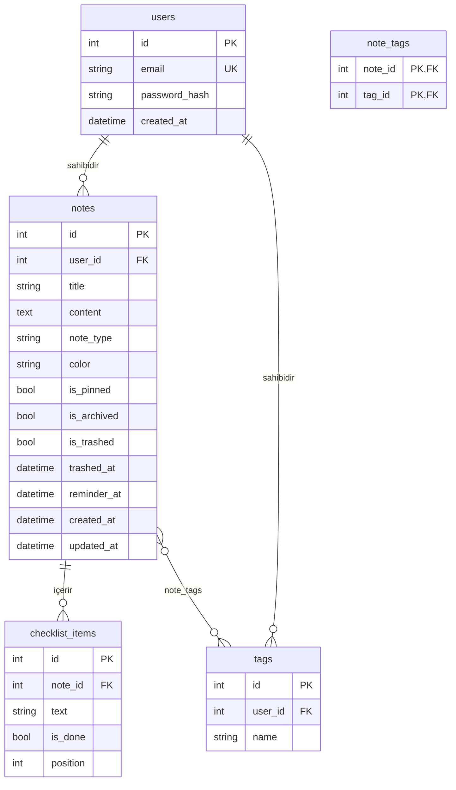

# Veri Modeli

Bu belge veritabanındaki tabloları, alanları ve tablolar arasındaki ilişkileri
açıklar. Kodda karşılığı: `backend/app/models.py`.

- Veritabanı: SQLite (adres `.env` dosyasındaki `DATABASE_URL` ile değiştirilebilir)
- Tablolar uygulama açılışında (ve `python -m app.seed` ile) otomatik oluşturulur.
- Model değişikliği ortak bir değişikliktir: önce ekiple konuşun, sonra bu belgeyi
  ve `models.py`'yi birlikte güncelleyin.

## İlişki şeması

## Tablolar

### `users` — `User`

Uygulamayı kullanan kişiler.

| Alan | Tip | Kural | Açıklama |
|---|---|---|---|
| `id` | int | birincil anahtar | |
| `email` | string(255) | benzersiz, zorunlu | Giriş e-postası |
| `password_hash` | string(255) | zorunlu | Parolanın özeti. Parolanın kendisi asla saklanmaz. |
| `created_at` | datetime | varsayılan: şu an (UTC) | Kayıt tarihi |

### `notes` — `Note`

Kullanıcının notları. Her not tek bir kullanıcıya aittir.

| Alan | Tip | Kural | Açıklama |
|---|---|---|---|
| `id` | int | birincil anahtar | |
| `user_id` | int | → `users.id`, zorunlu | Notun sahibi |
| `title` | string(255) | varsayılan `""` | Başlık (boş olabilir) |
| `content` | text | varsayılan `""` | Metin içeriği (`text` notlarda kullanılır) |
| `note_type` | string(20) | `"text"` veya `"checklist"`, varsayılan `"text"` | Not türü |
| `color` | string(20) | varsayılan `"default"` | Renk adı (aşağıdaki listeden) |
| `is_pinned` | bool | varsayılan `false` | Üstte sabitlenmiş mi |
| `is_archived` | bool | varsayılan `false` | Arşivde mi |
| `is_trashed` | bool | varsayılan `false` | Çöp kutusunda mı |
| `trashed_at` | datetime | boş olabilir | Çöpe atılma zamanı |
| `reminder_at` | datetime | boş olabilir | Hatırlatıcı zamanı |
| `created_at` | datetime | varsayılan: şu an (UTC) | Oluşturulma zamanı |
| `updated_at` | datetime | her güncellemede yenilenir | Son değişiklik zamanı |

Renk adları (frontend karşılığı: `frontend/src/components/noteColors.js`):
`default`, `red`, `orange`, `yellow`, `green`, `teal`, `blue`, `purple`, `pink`,
`brown`, `gray`.

Notun görüneceği yer bayraklara göre belirlenir:

| Sayfa | Koşul |
|---|---|
| Notlar | `is_archived = false` ve `is_trashed = false` |
| Arşiv | `is_archived = true` ve `is_trashed = false` |
| Çöp kutusu | `is_trashed = true` |

### `tags` — `Tag`

Kullanıcının etiketleri. Etiketler kullanıcıya özeldir.

| Alan | Tip | Kural | Açıklama |
|---|---|---|---|
| `id` | int | birincil anahtar | |
| `user_id` | int | → `users.id`, zorunlu | Etiketin sahibi |
| `name` | string(100) | zorunlu; aynı kullanıcıda benzersiz | Etiket adı |

### `note_tags` (ara tablo)

Notlar ile etiketler arasındaki çoka-çok ilişki. Bir notun birden çok etiketi,
bir etiketin birden çok notu olabilir.

| Alan | Tip | Kural |
|---|---|---|
| `note_id` | int | → `notes.id`, birincil anahtarın parçası |
| `tag_id` | int | → `tags.id`, birincil anahtarın parçası |

### `checklist_items` — `ChecklistItem`

`note_type = "checklist"` olan notların maddeleri.

| Alan | Tip | Kural | Açıklama |
|---|---|---|---|
| `id` | int | birincil anahtar | |
| `note_id` | int | → `notes.id`, zorunlu | Maddenin ait olduğu not |
| `text` | string(500) | varsayılan `""` | Madde metni |
| `is_done` | bool | varsayılan `false` | İşaretlendi mi |
| `position` | int | varsayılan `0` | Sıra (küçükten büyüğe gösterilir) |

## İlişkiler ve silme davranışı

| İlişki | Tür | Python'dan erişim | Üst kayıt silinince |
|---|---|---|---|
| User → Note | bire-çok | `user.notes`, `note.user` | Notlar da silinir |
| User → Tag | bire-çok | `user.tags`, `tag.user` | Etiketler de silinir |
| Note → ChecklistItem | bire-çok | `note.checklist_items` (position sıralı), `item.note` | Maddeler de silinir |
| Note ↔ Tag | çoka-çok (`note_tags`) | `note.tags`, `tag.notes` | Yalnızca ara tablodaki bağ silinir |

SQLite'ta yabancı anahtar kısıtları `database.py` içinde her bağlantıda açılır
(`PRAGMA foreign_keys=ON`).

## Erişim kuralı

Bir kullanıcı yalnızca kendi kayıtlarını görebilir ve değiştirebilir. Servisler
sorgularda her zaman `user_id == current_user.id` koşulunu kullanmalıdır.
Başka kullanıcıya ait bir kayıt istendiğinde `NotFoundError` (404) döndürülür.
